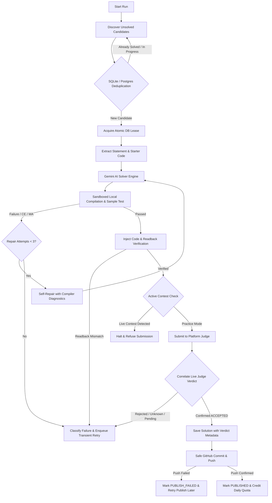

# 🤖 AutoCoder AI: Autonomous Multi-Platform Coding Agent

[](https://www.python.org/)
[](https://playwright.dev/)
[](https://aistudio.google.com/)
[](https://www.oracle.com/java/)
[](LICENSE)
[](https://github.com/Vinay-711/autonomous-coding-bot/actions)

An autonomous AI coding agent and scheduled cloud worker that discovers unsolved competitive programming problems, generates optimal **Java solutions** using **Google Gemini**, verifies them in a restricted local sandbox with `javac` and sample tests, injects them into web editors with readback verification, confirms strict judge verdicts, and publishes verified solutions to GitHub with independent quota tracking and crash recovery.

> [!IMPORTANT]
> **🔑 Bring Your Own API Key (BYOK)**:
> This tool is open-source and **requires each operator to provide their own Google Gemini API key**.
> - Get an API key from [Google AI Studio](https://aistudio.google.com/) or configure via Google Cloud Secret Manager.
> - Sensitive tokens and keys are never uploaded, committed, or exposed in logs; all runtime logs automatically redact API keys, tokens, session cookies, passwords, and PII.
> - Configure via `autocoder config` or set `GEMINI_API_KEY` in your environment or Secret Manager.

---

## 🌟 Supported Platforms

| Platform | Difficulty Targeting | Judge Verification Method | Canonical Target File |
| :--- | :--- | :--- | :--- |
| **LeetCode** | Easy / Medium / Hard | Live DOM & Result Details with Submission ID | `Solution.java` |
| **Codeforces** | Rating 800–2400 (Div 1/2/3) | Codeforces Official API (`verdict == OK`) | `Main.java` |
| **CodeChef** | Practice / Starters | Submission details modal & table verdict | `Main.java` |
| **HackerRank** | Algorithmic Subdomains | Submissions API correlated to current attempt | `Solution.java` |
| **HackerEarth** | BFS / DFS / DP / Trees | Submission container & live poll (never pending) | `TestClass.java` |

---

## ⚡ Architecture Flow



---

## ✨ Verified Capabilities & Safeguards

- **Judge Verdict Integrity**: Employs typed verdict states (`ACCEPTED`, `REJECTED`, `PENDING`, `UNKNOWN`, `ERROR`). Submissions are never marked accepted based on absence of errors or pending evaluations. Requires matching platform problem ID, account handle, submission timestamp, and submission ID to reject stale historical verdicts.
- **Sandboxed Java Verification & Repair**: Solutions are compiled and tested locally using `javac` with CPU limits, memory caps (512MB), execution timeouts (10s), process limits, and network isolation. Failed compilations feed compiler diagnostics back into Gemini for up to 3 repair iterations.
- **Safe Publishing & Structured State**: Decouples judge acceptance from publishing using `ProcessResult` (`GENERATED`, `COMPILED`, `TESTED`, `SUBMITTED`, `ACCEPTED`, `REJECTED`, `PUBLISH_FAILED`, `PUBLISHED`). Stages only the solution file and generated README (`git add .` is forbidden). Failed pushes can be retried without resubmitting to the judge.
- **Independent Quota Isolation**: Enforces separate per-platform quotas (e.g. 5 problems per platform). If one platform encounters rate limits or authentication barriers, its shortfall is reported honestly and never masked by over-allocating to another platform. Quota boundaries follow `Asia/Kolkata` midnight.
- **Anti-Bot & Human-in-the-Loop Policy**: Uses modular platform adapters with explicit authentication checks and URL verification. When CAPTCHA, Cloudflare challenges, or authentication barriers are detected, the bot safely pauses that platform and requests human action without attempting automated challenge bypass. Automatic submission into live rated contests is strictly blocked.
- **Cloud-Native Deployment**: Supports containerized deployment via Google Cloud Run Jobs and Google Cloud Scheduler (daily at 18:00 Asia/Kolkata). Reads credentials from Google Cloud Secret Manager and stores durable state in PostgreSQL or SQLite with heartbeat lease recovery.
- **Monitoring & Observability**: Emits structured JSON logs with sensitive credential redaction (API keys, GitHub tokens, JWTs, cookies, passwords, and emails). Implements persistent retry queues for transient errors, per-platform circuit breakers, and opt-in webhook notifications.

---

## 🚀 Installation

### Option 1: Global CLI Tool (macOS & Linux)
```bash
# Clone the repository
git clone https://github.com/Vinay-711/autonomous-coding-bot.git
cd autonomous-coding-bot

# Run installation script
chmod +x install.sh && ./install.sh
```

### Option 2: Clean Python Virtual Environment
```bash
python3 -m venv .venv
source .venv/bin/activate
pip install --upgrade pip
pip install -e .
playwright install chromium
```

### Option 3: Containerized Cloud Deployment
For Google Cloud Run Jobs and Cloud Scheduler deployment, see [CLOUD_DEPLOYMENT.md](CLOUD_DEPLOYMENT.md).

---

## 💻 CLI Commands & Usage

| Command | Description |
| :--- | :--- |
| `autocoder help` | Display available CLI commands, flags, and usage examples |
| `autocoder daily [--count N] [--mode run\|submit\|both]` | Execute daily batch across all 5 platforms with independent quota accounting |
| `autocoder solve <platform> [--count N]` | Run solver for a specific platform (`leetcode`, `codeforces`, `codechef`, `hackerrank`, `hackerearth`) |
| `autocoder status [--detailed]` | Display database summary, solved counts, circuit breakers, and retry queue status |
| `autocoder retry-failed [--dry-run]` | Inspect or dispatch transient failures from the persistent retry queue |
| `autocoder config` | Interactive configuration wizard to set or update API keys, handles, and directories |
| `autocoder schedule` | Configure local automated daily schedule (`launchd` on macOS or `cron` on Linux) |
| `autocoder chrome` | Launch local Chrome with CDP debugging on port 9222 for manual authentication |

### Mode Options
- `--mode run`: Generates, compiles, and tests solutions against sample cases locally. Never submits to online judges and never pushes to GitHub.
- `--mode save`: Verifies solutions locally and saves code to the local filesystem without judge submission or GitHub publishing.
- `--mode submit` or `--mode both`: Verifies locally, submits to online judge, confirms verdict, and publishes to GitHub upon confirmed acceptance.

---

## 🛠️ Verification & Testing

The repository includes a comprehensive test suite (138+ automated unit and release gate tests) that runs completely offline with mocked platform and judge responses:

```bash
# Run full offline test suite
pytest -v tests/

# Run code style & lint checks
ruff check .

# Run dependency vulnerability audit
pip-audit -r requirements.txt

# Run Python compilation check
python3 -m compileall bot.py tests/
```

---

## 📁 Repository Structure

```text
├── bot.py                   # Core autonomous agent, platform adapters, and CLI entrypoint
├── Dockerfile               # Multi-stage container build for cloud worker execution
├── pyproject.toml           # Package configuration, CLI entrypoint, and Ruff lint rules
├── requirements.txt         # Production runtime dependencies
├── install.sh               # Local CLI installer
├── run.sh                   # Interactive launcher script
├── CLOUD_DEPLOYMENT.md      # Google Cloud Run Jobs & Cloud Scheduler guide
├── deploy/                  # Kubernetes / Cloud Run YAML configurations and deployment scripts
├── .github/workflows/       # GitHub Actions CI workflow (lint, security audit, test matrix)
└── tests/                   # 100% offline mock test suite covering all release gates
```

---

## 🛡️ Responsible Automation & Disclaimers

- **Algorithmic Practice Only**: AutoCoder is intended for personal practice tracking, learning, and algorithmic research.
- **Contest Integrity**: Submissions to active, live rated contests are strictly blocked.
- **Anti-Bot Compliance**: Does not bypass CAPTCHA, Cloudflare Turnstile, or access controls. When interactive verification is required, the platform is paused and operator intervention is requested.
- **Truth-in-Reporting**: Daily run summaries report true counts of generated, compiled, tested, accepted, published, and failed problems without falsifying quotas or reallocating failed platform targets.

---

## 📄 License

This project is licensed under the [MIT License](LICENSE).
