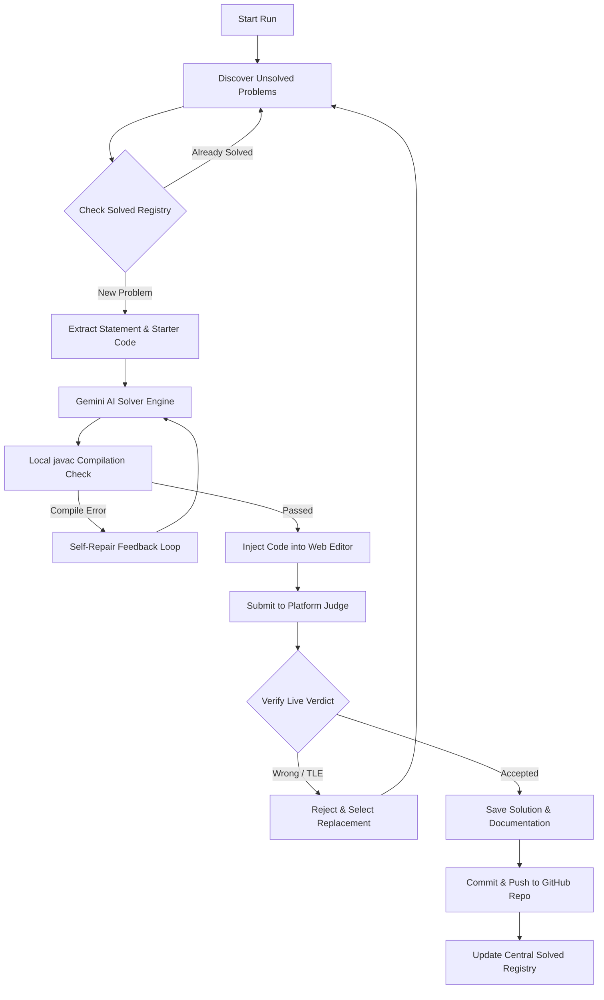

# 🤖 AutoCoder AI: Autonomous Multi-Platform Coding Agent

[](https://www.python.org/)
[](https://playwright.dev/)
[](https://aistudio.google.com/)
[](https://www.oracle.com/java/)
[](LICENSE)

An autonomous AI pair programmer that **discovers unsolved competitive programming problems**, writes optimal **Java solutions** using **Google Gemini**, verifies them locally with `javac`, injects them into the browser editor, validates live judge verdicts, and **automatically commits and pushes verified solutions to GitHub**.

---

## 🌟 Supported Platforms

| Platform | Difficulty Targeting | Judge Verification | Target GitHub File |
| :--- | :--- | :--- | :--- |
| **LeetCode** | Easy / Medium / Hard | Live DOM & Result Box | `Solution.java` |
| **Codeforces** | Rating 1200–2400 (Div 2/1) | Codeforces Official API | `Main.java` |
| **CodeChef** | Practice / Starters | Contest/Practice Judge | `Main.java` |
| **HackerRank** | Algorithmic Subdomains | HackerRank Submissions API | `Solution.java` |
| **HackerEarth** | BFS / DFS / DP / Trees | HackerEarth Submission JSON | `TestClass.java` |

---

## ⚡ Architecture Flow



---

## ✨ Key Features

- **Autonomous Discovery**: Dynamically scans platform APIs and practice catalogs for completely unsolved problems matching your requested difficulty.
- **Local Verification & Self-Healing**: Automatically compiles Java solutions with `javac` and tests sample inputs locally. If compilation fails, the exact compiler diagnostics are fed back into Gemini for up to 3 automated repair iterations.
- **Modern UI & Editor Support**: Native integration with Monaco Editor, Ace Editor, CodeMirror, and modern Radix UI / Tailwind dropdowns.
- **Zero-Broken-Code Guarantee**: Only solutions that pass local verification and receive a confirmed **Accepted** verdict from the judge are committed to GitHub.
- **Central Solved Registry**: Maintains a persistent deduplication registry (`solved_history.json`) across all platforms and local folders so no problem is ever repeated.
- **Cloudflare & Anti-Bot Resiliency**: Built-in desktop User-Agent masking, automated session handling, and direct Chrome DevTools Protocol (`CDP`) integration to pass Cloudflare Turnstile smoothly.
- **Native Daily Scheduling**: Includes a one-click macOS `launchd` scheduler (and Linux cron compatibility) for hands-free daily practice.

---

## 🚀 1-Minute Quickstart (Recommended)

Get started in 2 commands — zero complex setup or manual configuration required:

```bash
# 1. Clone the repository
git clone https://github.com/Vinay-711/autonomous-coding-bot.git
cd autonomous-coding-bot

# 2. Run the one-click launcher
chmod +x run.sh && ./run.sh
```

### What `run.sh` does automatically:
1. 🔍 **Prerequisite Checks**: Verifies Python 3 and Java (`javac`) on your machine.
2. 📦 **Virtual Environment**: Automatically creates `.venv` and manages it.
3. 📥 **Dependency Installation**: Installs Python libraries (`google-genai`, `playwright`, etc.) and downloads Chromium.
4. 🔑 **Interactive Setup Wizard**: Prompts you for a free Google Gemini API key (from [Google AI Studio](https://aistudio.google.com/)) and sets up `.env`.
5. 🎮 **Interactive Menu**: Lets you pick your routine, choose specific platforms, connect to real Chrome, or install background automation with a single keypress!

```text
╔═══════════════════════════════════════════════════════════════════════╗
║              🤖 AutoCoder AI: Autonomous Coding Agent                 ║
║       Multi-Platform Problem Solver • Java Verification • GitHub      ║
╚═══════════════════════════════════════════════════════════════════════╝

  [1] 🌟 Run Daily Quota (Solve 5 problems on ALL 5 platforms - 25 total)
  [2] 🎯 Solve a Single Platform (LeetCode, Codeforces, HackerRank, etc.)
  [3] 📄 Solve custom URLs from problems.txt
  [4] 🌐 Connect Real Chrome (Bypass Cloudflare Turnstile & anti-bot)
  [5] ⏰ Setup Automated Daily 6:00 PM Schedule (macOS Background Service)
  [6] ⚙️  Reconfigure API Keys & Settings
  [0] 🚪 Exit
```

---

<details>
<summary><b>🛠️ Alternative: Manual Setup (for advanced users)</b></summary>

### 1. Prerequisites
- **Python 3.10+**: Ensure Python is installed (`python3 --version`).
- **Java JDK 17 or 21**: Ensure `javac` and `java` are available on your PATH.
- **Google Chrome**: For browser automation and session persistence.
- **Gemini API Key**: Get a free API key from [Google AI Studio](https://aistudio.google.com/).

### 2. Manual Installation
```bash
# Clone the repository
git clone https://github.com/Vinay-711/autonomous-coding-bot.git
cd autonomous-coding-bot

# Create and activate virtual environment
python3 -m venv .venv
source .venv/bin/activate

# Install dependencies
pip install -r requirements.txt

# Install Playwright browser binaries
playwright install chromium
```

### 3. Manual Configuration
Copy `.env.example` to `.env` and fill in your credentials:
```bash
cp .env.example .env
```

Edit `.env`:
```env
# Google Gemini API Key
GEMINI_API_KEY="your-gemini-api-key-here"

# Your GitHub Username (optional, for auto-commit repositories)
GITHUB_USERNAME="your-github-username"

# Your Competitive Programming Handles (optional)
CODEFORCES_HANDLE="your-cf-handle"
LEETCODE_USERNAME="your-leetcode-username"
HACKERRANK_USERNAME="your-hackerrank-username"
HACKEREARTH_USERNAME="your-hackerearth-username"
CODECHEF_USERNAME="your-codechef-username"
```

</details>

---

## 💻 Usage

### Run Across All 5 Platforms
Solve 5 verified problems on every platform (25 problems total):
```bash
python3 bot.py --platform all --count 5 --difficulty medium-hard --mode both
```

### Run on a Single Platform
```bash
# LeetCode
python3 bot.py --platform leetcode --count 5 --difficulty medium-hard --mode both

# Codeforces
python3 bot.py --platform codeforces --count 5 --difficulty medium-hard --mode both

# HackerRank
python3 bot.py --platform hackerrank --count 5 --difficulty medium-hard --mode both

# CodeChef
python3 bot.py --platform codechef --count 5 --difficulty medium-hard --mode both

# HackerEarth
python3 bot.py --platform hackerearth --count 5 --difficulty medium-hard --mode both
```

### CLI Arguments
| Argument | Options | Description |
| :--- | :--- | :--- |
| `--platform` | `leetcode`, `codeforces`, `hackerrank`, `codechef`, `hackerearth`, `all`, `file` | Target platform to solve. |
| `--count` | Integer (default: `5`) | Target quota of verified **Accepted** solutions. |
| `--difficulty` | `easy`, `medium`, `hard`, `medium-hard` | Problem difficulty level. |
| `--mode` | `run`, `submit`, `both` | `run` (test only), `submit` (submit only), `both` (test & submit). |
| `--headless` | Flag | Run browser in headless mode (ideal for scheduled tasks). |

---

## 🌐 Handling Cloudflare Turnstile (Chrome CDP)

For platforms with strict Cloudflare Turnstile or anti-bot checks (like Codeforces), use the included helper script to connect directly to your trusted Google Chrome browser:

```bash
chmod +x connect_chrome.sh
./connect_chrome.sh --platform codeforces --count 5 --mode both
```

This launches your local Google Chrome with remote debugging on port `9222`, allowing the bot to interact through your existing trusted session without anti-bot blocks.

---

## ⏰ Automated Daily Scheduling

### macOS (`launchd`)
To schedule the bot to run automatically every day at 6:00 PM:
```bash
chmod +x setup_daily_schedule.sh
./setup_daily_schedule.sh
```

- **Check status**: `launchctl list | grep codingbot`
- **View live logs**: `tail -f logs/daily_run.log`
- **Stop schedule**: `launchctl unload ~/Library/LaunchAgents/com.vinxy.codingbot.plist`

### Linux (`cron`)
Add the following entry using `crontab -e`:
```cron
0 18 * * * cd /path/to/autonomous-coding-bot && .venv/bin/python3 bot.py --platform all --count 5 --mode both --headless >> logs/daily_run.log 2>&1
```

---

## 📁 Repository Structure

```text
├── bot.py                   # Core autonomous agent & multi-platform runner
├── connect_chrome.sh        # Remote Chrome CDP connector for Turnstile bypass
├── setup_daily_schedule.sh  # macOS launchd automated schedule installer
├── requirements.txt         # Project dependencies
├── .env.example             # Environment configuration template
├── .gitignore               # Strict exclusion rules for secrets and sessions
├── LICENSE                  # MIT License
└── README.md                # Documentation & architecture guide
```

---

## 🛡️ Disclaimer & Ethical Use

This software is designed for educational, algorithmic research, and personal practice tracking purposes. Users are responsible for complying with the Terms of Service of each competitive programming platform. Automated practice submissions are distinct from rated, real-time contest participation.

---

## 📄 License

This project is licensed under the [MIT License](LICENSE).
